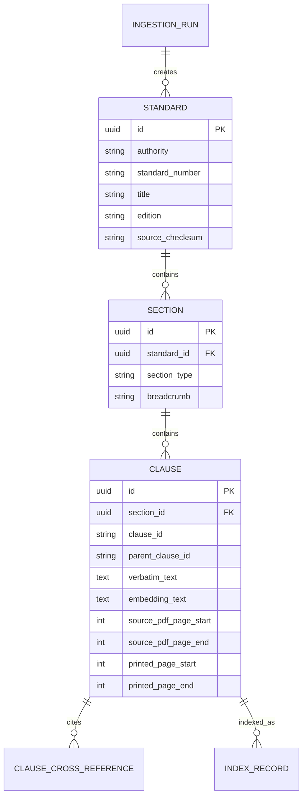
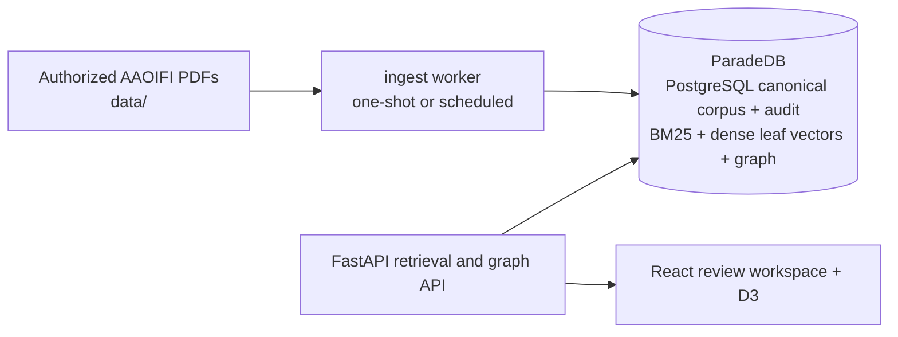

# AAOIFI Standards Ingestion Plan

**Status:** The supplied English compilation is ingested into PostgreSQL as a draft, source-traceable corpus. It remains unavailable for approved/public retrieval until source-use rights and scholar approval are recorded.

## Objective

Create a Docker-hosted AAOIFI standards corpus that can support reliable, clause-level evidence in the Shariah Compliance Copilot. The system must retrieve the correct clause for a contract finding and return a verifiable citation, page reference, and verbatim source text.

This plan follows the supplied structure-first strategy: a numbered AAOIFI clause is the citation atom. Token size must never determine a primary chunk boundary.

## Scope

The first release ingests the supplied AAOIFI English compilation at `data/Shariaa-Standards-ENG.pdf`: all 54 standards are retained as page-level source records, while SS 8 Murabahah also has its validated clause-level structure needed by the current demo. The system will support multiple standards and revisions after the parser is proven against the real source layout.

It does not create new Shariah rulings, treat a retrieved clause as an autonomous compliance decision, or overwrite an earlier source edition.

## Verified Source Inspection

The supplied file has passed technical inspection. It is not yet approved for publication in the searchable corpus because the applicable use rights and scholar approval are not recorded.

| Item | Verified finding |
| --- | --- |
| Source | `data/Shariaa-Standards-ENG.pdf` |
| SHA-256 | `b10b13e094de4b59a367320404b9796f8cc11dcce01c7702ec8d7f1c49c0e8f2` |
| Format | PDF 1.7, 12 MB, A4, 1,264 PDF pages, not encrypted |
| Authority and language | Accounting and Auditing Organization for Islamic Financial Institutions (AAOIFI); English |
| Publication | *Shari’ah Standards*, Manama, 2015; ISBN `6-9616-01-603-978` (as printed in the publication data) |
| Target standard | **Shari’ah Standard No. (8): Murabahah (Revised Standard)** |
| Standard history | Issued 16 May 2002; its Appendix C says the Shari’ah Board adopted the current amended version in November 2014 |
| Standard boundaries | Cover: PDF page 196 / printed page 195; statement: PDF pages 201-215 / printed pages 200-214; adoption: PDF page 216; appendices: PDF pages 217-232; SS 9 begins at PDF page 234 |
| Text-layer quality | Text is selectable, but glyphs are systematically duplicated. Page-aware character de-duplication reduced the SS 8 normative pages to a median 54.6% of their raw extracted character count and restored readable English text. |
| Visual verification | Rendered and inspected the cover, opening rules page, clause-continuation page, pricing rules page, and late-payment page. The source has a stable running header and printed page footer. |

The plan cites both page systems while the PDF remains the rendered source: `source_pdf_page` is the physical PDF page and `printed_page` is the page number shown in the publication. The user interface should display the printed page and retain the PDF page for source navigation.

The publication notice reserves reproduction and information-storage/retrieval rights. It also states that the Arabic text prevails where the Arabic and English texts differ. The English corpus therefore supports the demonstration only after written permission or another documented entitlement is recorded, and every English citation must retain an `arabic_precedence_notice` until an Arabic-source comparison has been approved.

## Source Acceptance Gate

Before extraction, the ingestion service produces a manifest for scholar or administrator review. An ingestion run cannot become searchable until the manifest is approved.

Required manifest fields:

| Field | Reason |
| --- | --- |
| Source filename and SHA-256 checksum | Detect changes and preserve provenance |
| Authority | `AAOIFI` |
| Edition, publication date, and language | Citations are edition-specific |
| Standard number and official title | Stable retrieval and display identity |
| Page count and extraction method | Traceability and quality control |
| Rights/usage confirmation | The corpus must be an authorized source |
| Arabic-text precedence handling | The source says Arabic prevails where the English and Arabic texts differ |
| Ingestion parser version | Reproducibility |

The source validator rejects password-protected, unreadable, duplicate, or unapproved files. It flags scanned PDFs for OCR and confirms that a text layer has not duplicated the table of contents or repeated page furniture. For this supplied file, duplicate-glyph remediation is required before parsing; raw text must never be embedded or quoted.

## Canonical Content Model

The PostgreSQL database is the system of record. Search engines contain copies keyed by immutable clause IDs; no search index is the source of a quote.



Each searchable leaf record includes:

```text
authority: AAOIFI
standard_number: SS 8
standard_title: Murabahah
publication: Shari’ah Standards (2015), English
standard_version: Revised Standard; current amended version described in Appendix C
clause_id: 5/8
parent_clause_id: null
section_type: statement_rule
breadcrumb: Statement of the Standard > 5. Guarantees and Treatment of Murabahah Receivables > 5/8
source_pdf_page_start: 215
source_pdf_page_end: 215
printed_page_start: 214
printed_page_end: 214
verbatim_text: <unaltered clause text>
embedding_text: <normalized, header/footer-free representation>
cross_references: [<linked clause IDs or standards>]
source_checksum: <SHA-256>
```

The ingestion record also retains `raw_page_text` and page-word coordinates as extraction evidence. `verbatim_text` is the canonical, line-order-preserving transcription created after the documented duplicate-glyph repair, with running headers/footers removed. It is immutable after approval and is the only field allowed to supply a quotation. `embedding_text` can additionally normalize whitespace, join line-wrap hyphenation, and prepend citation context for retrieval; it cannot replace the canonical text.

## Parsing and Chunking Design

1. **Extract page-aware text and geometry.** Use `pdfplumber` word coordinates with character de-duplication as the primary path for this source; preserve the unmodified raw extraction by page. Use OCR only for a page lacking usable text after this step.
2. **Apply the source-specific quality gate.** Require duplicate-glyph remediation on all SS 8 pages, retain the raw-to-clean character ratio, remove the repeated running header at the top of the page and the printed page number at the footer, and reject a preview if the median clean/raw ratio materially departs from the observed 0.546 baseline. Do not use the table of contents as content.
3. **Parse only the verified SS 8 boundaries.** Begin at PDF page 196, classify the cover, preface, statement, adoption, and appendices separately, and stop before SS 9 on PDF page 234. The initial searchable rules corpus is the Statement of the Standard on PDF pages 201-215; appendices are retained as a separate, non-normative source class until approved for retrieval.
4. **Recognize the actual hierarchy by geometry and grammar.** In the statement body, major sections are `N.` at x≈120 pt, intermediate or direct clauses are `N/N` at x≈132 pt, and nested clauses are `N/N/N` at x≈152 pt. Accept a small tolerance for two-digit clause IDs. A number at any other indentation is a cross-reference or footnote, not a new chunk; for example, the inline `3/1/5` on printed page 207 and the inline `5/6` on printed page 214 must remain part of their enclosing clauses.
5. **Build the hierarchy.** Create `Standard → named major section → clause → sub-clause` records with parent IDs, breadcrumb, source PDF pages, and printed pages. In SS 8, `2/1` and `3/1` are intermediate headings while `4/1` and `5/8` are direct citation leaves. The scope under major section `1` is a citable scope leaf; section `6` is standard metadata rather than a rule chunk.
6. **Create leaf chunks.** One citation leaf becomes one chunk. SS 8’s statement preview should yield six major headings, 28 `N/N` records, 42 `N/N/N` records, 63 rule leaves, and one scope leaf. No arbitrary token split is allowed. Only an unusually long clause may split at sentence boundaries; each part preserves the same clause ID with a part suffix and approximately 15% sentence overlap.
7. **Repair only presentation artifacts in retrieval text.** The canonical transcription preserves the source’s word order and page trail. `embedding_text` may join a line-wrap word such as `contrac-` + `tual`; the original line evidence remains available for visual comparison. A quote must resolve back to `verbatim_text` and its rendered source page.
8. **Create parent context.** Store sections and parent clauses in PostgreSQL. Assemble sibling context at retrieval time; do not embed duplicate large parent documents.
9. **Extract links.** Detect mentions of other AAOIFI standards and clauses; keep raw match text and a resolution status so ambiguous references can be reviewed.
10. **Approve before publishing.** A sample of parsed clauses, including cross-page clauses `2/1/3`, `3/1/1`, `3/2/2`, `5/5`, and inline-reference cases, must be reviewed against the rendered PDF before records are indexed.

### SS 8 Parser Configuration Proposal

```yaml
source:
  path: data/Shariaa-Standards-ENG.pdf
  sha256: b10b13e094de4b59a367320404b9796f8cc11dcce01c7702ec8d7f1c49c0e8f2
  authority: AAOIFI
  language: en
publication: "Shari’ah Standards (2015)"
arabic_precedence_notice: true
standard:
  number: "8"
  title: "Murabahah"
  label: "Revised Standard"
  pdf_page_range: [196, 232]
  statement_pdf_page_range: [201, 215]
  printed_page_offset: -1
extraction:
  engine: pdfplumber
  dedupe_chars_tolerance: 1
  body_top_min_pt: 145
  body_bottom_max_pt: 710
  page_header: "Shari’ah Standard No. (8): Murabahah"
headings:
  major_section: { pattern: '^([1-6])\\.$', x0_pt: 120.4, tolerance_pt: 5 }
  clause: { pattern: '^([1-5]/[0-9]+)$', x0_pt: 131.8, tolerance_pt: 5 }
  subclause: { pattern: '^([1-5]/[0-9]+/[0-9]+)$', x0_pt: 151.6, tolerance_pt: 5 }
```

The parser must not assume this configuration applies to the other 53 standards in the compilation. It is a verified SS 8 profile and a reference for building a configurable parser.

## Docker-Hosted Architecture

The demo uses Docker Compose with local persistent volumes. It runs BM25 and dense-vector retrieval as separate query branches inside ParadeDB because legal-text questions often need both exact terminology and semantic matching.



| Service | Image role | Persistent data | Exposure |
| --- | --- | --- | --- |
| `api` | FastAPI graph lookup service | None | `8000` local only |
| `postgres` / ParadeDB | Canonical source, metadata, ingestion audit, BM25, dense leaf vectors, and graph | Named volume | `5432` local only |
| `frontend` | React review workspace and D3 relationship map | None | `5174` local only by default |

`docker compose up --build` starts the implemented PostgreSQL, API, and frontend services. The ingestion worker remains the next build item. Its validate, preview, and publish operations must be explicit, never automatic on container start.

The initial Docker network is private to the Compose project. The future ingestion worker must mount the source directory read-only; no input PDF is copied into an image layer. Secrets such as the embedding provider key are provided through `.env`, excluded from version control, and never logged.

### Why this differs from the existing architecture

The architecture document specifies Pinecone for a managed production deployment. The local demo uses ParadeDB 0.25.9 as the Docker-hosted PostgreSQL-compatible service: its `pg_search` extension supplies BM25 and its included `pgvector` supports dense clause vectors. Graph edges and traversal stay in PostgreSQL relational tables. This simplifies the local operational boundary while preserving immutable clause IDs and citation contracts. ParadeDB Community is AGPLv3; use legal review or a commercial licence before distributing a Capco-hosted service. Its evaluated vector path is beta in 0.25.x and must pass the approved evaluation set.

## Retrieval, Reranking, and Grounding

1. Normalize the query and recognize direct citation searches such as `SS 8 5/5` before semantic retrieval.
2. Run ParadeDB BM25 and dense leaf-vector retrieval independently, requesting 8–12 candidates from each.
3. Filter candidates by authority, standard, edition, language, jurisdiction, and approval status when those filters are present.
4. Fuse rankings using reciprocal rank fusion.
5. Optionally expand high-confidence clauses or concepts through one to three approved graph hops. The graph can improve recall but cannot create a citation or replace direct clause retrieval.
6. Rerank the fused candidates with a cross-encoder. Return the best 3–5 clauses and assemble limited parent-section context only when needed.
7. The implemented `POST /api/v1/standards/search` executes the sparse branch, optional vector branch, direct-citation branch, and reciprocal-rank fusion; it returns no results until approved clause records exist.
8. Pass the model only approved source records with `standard_number`, `clause_id`, page numbers, and `verbatim_text`.
9. Verify every output quotation against the cited clause’s `verbatim_text`. Any quote that fails exact or approved near-exact matching is removed and the response is marked as unable to quote the source.

The retrieval API returns a citation object instead of an unstructured string:

```json
{
  "authority": "AAOIFI",
  "standard": "SS 8",
  "title": "Murabahah",
  "publication": "Shari’ah Standards (2015)",
  "standard_version": "Revised Standard",
  "clause_id": "5/8",
  "source_pdf_page_start": 215,
  "source_pdf_page_end": 215,
  "printed_page_start": 214,
  "printed_page_end": 214,
  "quote": "<verbatim approved span>",
  "quote_verified": true,
  "source_checksum": "<sha256>"
}
```

## User Experience Changes

### Administrator ingestion view

The admin sees source files, checksum, edition, extraction quality, parsed standards, clause count, unresolved cross-references, and a sample clause/page comparison. The only publish action is enabled after approval.

### Reviewer evidence view

The existing evidence panel replaces illustrative AAOIFI labels with retrieved citation cards. Each card shows the verified standard, clause number, printed page, PDF-page link, publication and standard version, verbatim quote, and a link to the underlying source page. A failed grounding check is visible as “Citation requires scholar verification”; it is never silently shown as a verified authority.

The current front-end prototype contains illustrative SS 8 labels that are not supported by the inspected source and must be corrected before the demo calls them verified:

| Demo finding | Current label | Correct source handling |
| --- | --- | --- |
| Time-based late-payment charge | `SS 8 · 5/5` | Use SS 8 `5/8` for an additional payment benefiting the institution; add `5/6` only when the charity undertaking is relevant. |
| Variable profit benchmark | `SS 8 · 3/2/2` | Use SS 8 `4/6`, which requires price and profit to be fixed and known at contract signature and excludes a future LIBOR-based determination. |
| No identified underlying asset | `SS 8 · 2/2/1` | Do not cite `2/2/1`; it addresses a sale already concluded between customer and supplier. Map this finding through a scholar-reviewed rule set, with candidate evidence from the acquisition and possession clauses such as `3/1/1` and `3/2/2`. |

The web design remains a Capco-style decision workspace: dark graphite navigation and determination band, restrained red for critical risk and human-governance actions, paper-white evidence surfaces, editorial headings, compact audit metadata, and a prominent statement that qualified scholars retain final authority. The first integration replaces static citation strings with the API citation object and adds a “source checked” state with printed page, version, checksum trace, and a rendered-page link.

## API Contract

| Endpoint | Purpose |
| --- | --- |
| `POST /api/v1/standards/ingestions/validate` | Create a source manifest and extraction-quality report |
| `POST /api/v1/standards/ingestions/{id}/approve` | Record the administrator or scholar approval required before indexing |
| `POST /api/v1/standards/ingestions/{id}/publish` | Index approved clauses idempotently |
| `GET /api/v1/standards/{standard}/clauses/{clause}` | Retrieve the canonical clause and page metadata |
| `POST /api/v1/standards/search` | Hybrid BM25 + dense search with filters and citations |
| `POST /api/v1/standards/graph/lookup` | Bounded, approved evidence-graph traversal for the D3 relationship map |
| `POST /api/v1/standards/verify-quote` | Verify generated quote spans against canonical text |

All write endpoints create an immutable ingestion-audit record. Only the system administrator can validate or publish; scholars can approve and annotate source accuracy.

## Implementation Sequence

1. **Source acceptance:** Record the verified source metadata and checksum, obtain written permission or another documented entitlement for local storage and retrieval, preserve the Arabic-precedence notice, and obtain scholar approval for the 2015 English compilation.
2. **Container foundation:** Add Compose, Dockerfiles, private network, volumes, health checks, `.env` variables, and database migrations.
3. **Canonical schema:** Implement source, ingestion-run, section, clause, cross-reference, page-coordinate evidence, and audit tables; add source checksum and idempotent keys.
4. **Extraction pipeline:** Build the `pdfplumber` de-duplication path, page geometry capture, header/footer removal, OCR fallback, and per-page quality artifacts.
5. **Hierarchy parser:** Implement the verified SS 8 parser profile and a generic configurable state machine. Build a preview report with the expected 64 citable records before any search-index write.
6. **Scholar review:** Compare selected cross-page, sub-clause, and inline-reference cases against the rendered source and approve the parsed preview.
7. **Indexing pipeline:** Produce leaf chunks, parent contexts, embedding text, ParadeDB BM25/vector records, cross-references, and evidence-bearing graph nodes/edges; make publish rerunnable without duplicates.
8. **Retrieval service:** Implement citation lookup, sparse/dense retrieval, RRF, bounded approved graph expansion, reranking, caching, and source filters.
9. **Grounding gate:** Add quotation verification and retrieval-response audit records.
10. **Front-end integration:** Replace the three incorrect static demo citations with API-backed citation cards, create the ingestion-review screen, and expose the D3 relationship map from approved evidence.
11. **Evaluation:** Run a signed scholar-reviewed query set before presenting citations as verified in the Capco demo. Compare graph-expanded and non-expanded retrieval precision.

## Acceptance Criteria

- The system rejects a standard lacking checksum, authority, publication/language, documented use entitlement, Arabic-precedence handling, or approval status.
- For the supplied file, the parser rejects any SS 8 publish preview unless duplicate-glyph repair, header/footer removal, and page-coordinate capture complete successfully.
- Every indexed leaf maps to one source clause/sub-clause and one or more source pages.
- The SS 8 preview returns 64 citable records: its scope plus 63 statement rules, with correct source PDF and printed-page references.
- No normal clause is split on a token boundary, and parent context is reconstructable from the canonical database.
- The parser catches repeated/duplicated extraction text before index publication.
- Re-running a published ingestion creates no duplicate canonical clauses, BM25 documents, or vector IDs.
- Citation lookup by standard and clause ID returns the exact source clause, edition, and pages.
- For a scholar-reviewed query set, top-five hybrid retrieval includes the expected clause at an agreed target rate before demo use.
- A generated quotation is displayed only when it passes the verbatim source check.
- A user can inspect the full source trail for any citation in the contract-review interface.
- A one- or two-hop graph lookup returns only approved, evidence-bearing edges; the query enforces depth, node, edge, and cycle limits.
- The D3 payload has stable IDs and never contains an unapproved edge.
- `EXPLAIN` verifies the expected top-k index plan for lexical and vector retrieval on the approved corpus.
- `docker compose up --build` can host the services locally, and the explicit ingestion commands complete from a mounted corpus.

## Remaining Gates Before Implementation

The supplied source now resolves the earlier corpus-discovery blocker. The remaining gates are confirmation of authorized use for the locally hosted corpus and scholar approval of the extracted SS 8 preview, citation mappings, and graph edges. Docker infrastructure, a graph lookup API, and the D3 demo map are now implemented; the AAOIFI source itself remains unindexed until those gates are passed.
