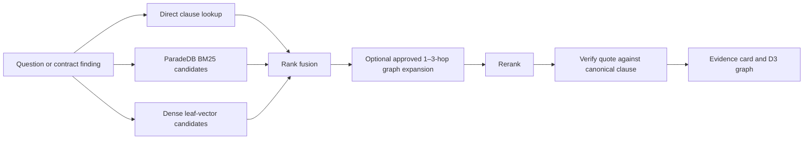

# Knowledge Graph and PostgreSQL Retrieval Design

**Status:** Implemented as a Docker-hosted demo foundation. Publication of AAOIFI-derived content remains gated by documented use rights and scholar approval.

## Decision

Use **ParadeDB 0.25.9** as the local, PostgreSQL-compatible data service. It provides canonical PostgreSQL tables, `pg_search` BM25, and `pgvector` dense retrieval in a single Docker service. Model the knowledge graph in relational tables and traverse it with bounded recursive SQL.

The interface uses **D3.js** only to lay out the returned JSON subgraph. D3 does not require a graph database or Cypher; it needs stable node and edge IDs.

| Requirement | Core PostgreSQL | ParadeDB | Apache AGE |
| --- | --- | --- | --- |
| Canonical AAOIFI corpus and audit records | Yes | Yes | Yes |
| Lexical retrieval | `tsvector` / GIN, not native BM25 | Native BM25 | Depends on added extensions |
| Dense leaf vectors | Requires `pgvector` | Included (`vector` 0.8.4) | Not included in evaluated image |
| One-service Docker demo | Yes, with extensions assembled | Yes | Graph only |
| Bounded graph traversal | `WITH RECURSIVE` | `WITH RECURSIVE` | Yes |
| openCypher | No | No | Yes |

### Recommendation

The demo uses ParadeDB plus a relational property-graph model. It gives a simple local deployment, one audit boundary, BM25, dense vector candidates, and evidence-first graph paths.

Apache AGE is the optional future profile if a genuine openCypher console is a hard requirement. It was tested separately: `apache/age:latest` (AGE 1.8.0, PostgreSQL 18.6, arm64) executed the relationship query below, but its image did not contain `pgvector`. ParadeDB’s image contained `pg_search 0.25.9` and `vector 0.8.4`, but no AGE extension. Combining them requires a custom image and compatibility testing, so it is not part of this demo.

```cypher
MATCH p = (risk:RiskPattern {id: 'variable-profit'})-[*1..2]->(target)
RETURN p
```

That experiment returned a path from **Variable profit benchmark** to **Fixed price and profit**, then to **SS 8 4/6**. The shipped API expresses that same business lookup using safe, parameterized recursive SQL; it does not expose arbitrary Cypher to a browser.

## Retrieval Design

A numbered AAOIFI clause remains the primary citation and retrieval leaf. Dense vectors do not replace it.



1. Resolve a direct citation such as `SS 8 4/6` first.
2. Retrieve lexical candidates through ParadeDB BM25 and semantic candidates through the vector field, restricted to approved language, authority, and edition records.
3. Fuse candidate ranks with reciprocal rank fusion, then rerank the small candidate set.
4. Expand from high-confidence clauses or concepts through a maximum of three approved graph hops. Graph expansion is recall support only; it cannot create a citation or replace a retrieved clause.
5. The implemented `POST /api/v1/standards/search` runs the sparse branch, optional vector branch, direct-citation branch, and reciprocal-rank fusion. It returns no results until approved clause records exist.
6. Quote only from `clause.verbatim_text`, and display it only after exact or approved near-exact verification.

The evaluated ParadeDB index form is:

```sql
CREATE INDEX clause_search_idx ON clause
USING paradedb (
  id,
  clause_id,
  embedding_text,
  language,
  approval_status,
  embedding vector_cosine_ops
)
WITH (key_field = 'id');
```

The experimental BM25 branch returned SS 8 `4/6` for `future LIBOR profit`; the dense branch returned `4/6` as its nearest vector. `EXPLAIN` showed ParadeDB’s `TopKScanExecState` for the vector top-k branch. The production evaluation must repeat this on the approved AAOIFI set because ParadeDB’s vector path is beta in the evaluated 0.25.x release.

## Evidence-Bearing Graph Model

The database schema is [001_knowledge_graph.sql](/Volumes/Orico/code/capco/islamic-ai/shariah/src/backend/app/db/migrations/001_knowledge_graph.sql:1).

| Table | Purpose |
| --- | --- |
| `graph_node` | Stable node identity, type, label, description, status, and optional clause link |
| `graph_node_alias` | Search aliases and language forms |
| `graph_edge` | Directed relationship with evidence, provenance, confidence, and review status |
| `graph_projection_run` | Versioned record of the graph projection used in a release |

Nodes include `standard`, `section`, `clause`, `concept`, `contract_type`, `risk_pattern`, `rule`, `control`, `finding`, and `authority`. Edges use a restricted vocabulary: `CONTAINS`, `PARENT_OF`, `CITES`, `DEFINES`, `GOVERNS`, `REQUIRES`, `PROHIBITS`, `PERMITS`, `CONFLICTS_WITH`, `EVIDENCED_BY`, and `RELATED_TO`.

Every edge records the source clause where available, source page, extraction method, confidence, approval state, scholar reviewer, and source ingestion run. An inferred edge is always `draft` until reviewed. No inferred edge becomes authoritative merely because it is retrieved or visually persuasive.

### Safe traversal contract

`POST /api/v1/standards/graph/lookup` accepts a graph seed and fixed limits:

```json
{
  "seed": "variable-profit-benchmark",
  "max_hops": 2,
  "node_limit": 50,
  "edge_limit": 75
}
```

The recursive SQL:

- matches canonical keys, labels, and aliases;
- filters every node and edge to `approval_status = 'approved'`;
- caps depth at 3 in request validation;
- prevents cycles by retaining the visited UUID path;
- bounds returned paths, nodes, and edges;
- returns graph-shaped JSON rather than raw database rows.

The client response is stable and D3-ready:

```json
{
  "seed": {"id": "risk:variable-profit-benchmark", "type": "risk_pattern", "label": "Variable profit benchmark"},
  "nodes": [{"id": "clause:ss8:4/6", "type": "clause", "label": "SS 8 · 4/6", "printed_page": 211}],
  "edges": [{"source": "risk:variable-profit-benchmark", "target": "rule:fixed-price", "predicate": "CONFLICTS_WITH", "evidence_clause_id": "4/6", "approval_status": "approved"}],
  "paths": [{"node_ids": ["risk:variable-profit-benchmark", "rule:fixed-price", "clause:ss8:4/6"]}],
  "truncated": false
}
```

## D3 Relationship Explorer

The Capco-style review workspace now exposes **Explore relationship map** from its evidence panel. The implementation is [KnowledgeGraphExplorer.tsx](/Volumes/Orico/code/capco/islamic-ai/shariah/src/frontend/src/components/KnowledgeGraphExplorer.tsx:1).

- A focused right-side drawer retains the contract-review context.
- D3 force layout provides an overview; click or keyboard-select a node to inspect it.
- Node colors distinguish entity type: red for clauses/findings, amber for risk patterns, green for rules, blue for controls, graphite for standards.
- Edge labels identify the predicate; the inspector shows the source clause and printed page when available.
- The temporary preview is visibly labelled and uses only demo mapping. When the API is running against an approved corpus, it replaces that preview automatically.
- The hard display cap is 50 nodes, 75 relationships, and 3 hops. A larger relationship map is a search problem, not an audit experience.

## Docker deployment

[docker-compose.yml](/Volumes/Orico/code/capco/islamic-ai/shariah/docker-compose.yml:1) launches:

| Service | Local port | Role |
| --- | --- | --- |
| `postgres` | `5432` loopback only | ParadeDB canonical corpus, BM25/vector retrieval, graph tables |
| `api` | `8000` loopback only | FastAPI graph lookup contract |
| `frontend` | `5173` loopback only | React review workspace and D3 explorer |

The source folder is not mounted into a general-purpose API process. A future ingestion worker must mount it read-only and publish only an approved ingestion run. The Compose frontend uses port `5174` by default to avoid replacing the existing local Vite session on `5173`.

Start the demo with:

```bash
docker compose up --build
```

## Demo acceptance checks

- A one- or two-hop lookup returns only approved edges and nodes.
- Every displayed edge has a source clause or a scholar-reviewed annotation.
- The traversal refuses depths above three and prevents cycles.
- D3 receives stable IDs and never receives a draft or rejected edge.
- BM25 and dense branches are both validated with `EXPLAIN`; ParadeDB’s top-k plan must be confirmed on the approved corpus.
- Evaluation compares PostgreSQL `tsvector` + `pgvector`, ParadeDB BM25 + dense vector, and graph-expanded versus non-expanded retrieval precision.
- Before a Capco-hosted distribution, legal reviews ParadeDB Community’s AGPLv3 terms or a commercial alternative.

## Uploaded-contract semantic graph

An uploaded contract produces its own graph after semantic extraction. Every displayed finding retains a verbatim excerpt that is checked against the uploaded PDF before it is returned. The graph uses those extracted clauses as evidence nodes and stores candidate finding, concept, and control relationships in the local `contract_analysis_graph` PostgreSQL table. These relationships are explicitly `candidate` and do not mix with the approved AAOIFI corpus graph.

`POST /api/v1/contracts/graph/query` supports a deliberately bounded Cypher-compatible read grammar for an uploaded analysis, for example:

```cypher
MATCH (f:finding)-[r:EVIDENCED_BY]->(c:clause) RETURN f,r,c
```

It supports one node match or one directed relationship match, with optional node type, relationship type, and exact `id` or `label` property matching. It does not execute Cypher, SQL, writes, variable-length paths, or arbitrary expressions. The service filters the persisted graph in application code and returns a D3-ready subgraph. PostgreSQL remains the persistence and retrieval boundary; Apache AGE remains an optional future choice only if full openCypher is required.
